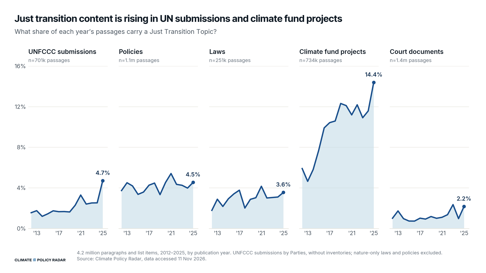
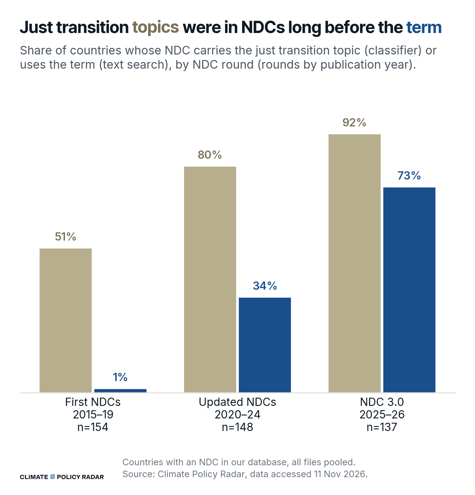
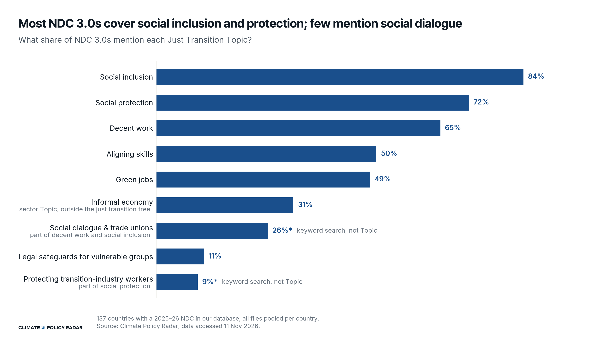
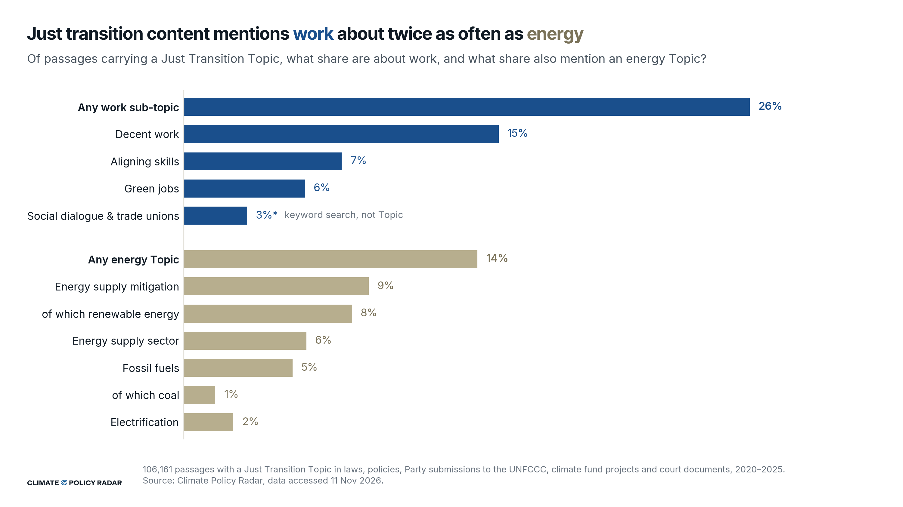
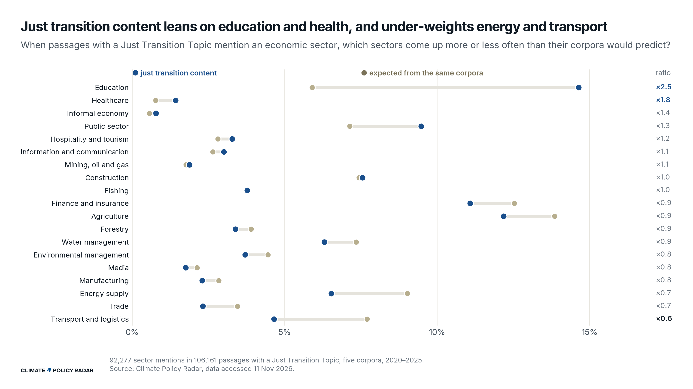
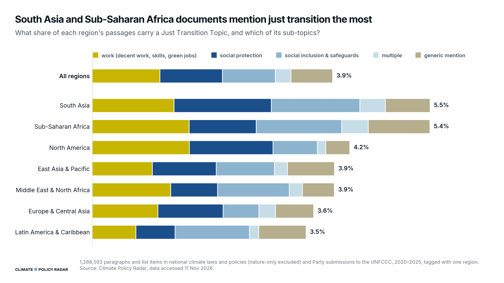
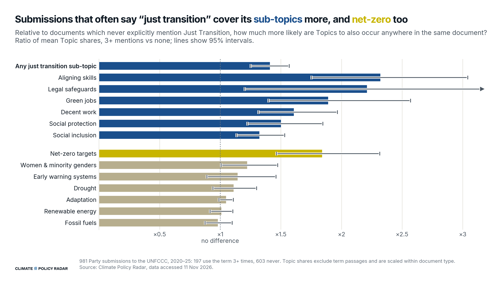

# Just transition charts for COP31

Written by Claude (Anthropic) with Anne Sietsma, 10–11 November 2026.

These charts replace the climate-justice graphs in the analysis section of *COP31 | ILO - Just
Transition Pavilion | Using Evidence to Make Just Transition Policy Work*. The open comments
there are "TODO: make some more appropriate COP specific graphs" and "TODO - update". Data is
from Snowflake `PRODUCTION.PUBLISHED`, accessed 11 Nov 2026.

```bash
uv run python demos/just_transition_cop31/concepts.py        # concept-store trees -> data/concepts.json
uv run python demos/just_transition_cop31/build_topic_sql.py # writes queries/03_topic_flags.sql
snow sql -f demos/just_transition_cop31/queries/<query>.sql --format json   # then save rows to data/
uv run python demos/just_transition_cop31/charts.py           # figures/
```

## Topics first

The charts build on **Topics**, our classifier output, not on wording. Topics are
hierarchical. The just transition Topic (`Q47`) contains its sub-topics: social protection,
social inclusion, decent work, aligning skills, green jobs and legal safeguards. So every
passage about social protection is also a just transition passage, and counts as one.

| Term in the charts | What it is |
|---|---|
| **Just Transition Topic** | The `Q47` classifier: its own labels plus every sub-topic's. A validated classifier. |
| **Sub-topics** | The six validated classifiers below the root, grouped into *work* (decent work, aligning skills, green jobs) and *social protection or inclusion* (social protection, social inclusion, legal safeguards). |
| **Generic mention** | Tagged with the Topic but none of the six sub-topics, so reached only through the root's own labels ("just transition", "fair transition", "leave no one behind" …) or label-only descendants. |
| **Keyword search** | Concept-store labels matched in SQL for concepts inside the tree that have no classifier: social dialogue & trade unions, and protecting transition-industry workers. Marked with an asterisk and "keyword search, not Topic". |
| **The term** | A text search for "just / fair / equitable (energy / ecological) transition". Used only where the point is to compare wording with Topics: charts 2b and 7. |

An earlier draft started from the term and asked which Topics appear in those passages. That
drops most just transition content, and it reversed several findings:
- the term travels with energy framing, but Topic content does not;
- the term over-weighted mining and energy, while Topic content leans on education and health;
- most term passages are generic, but most Topic content is not.

## Where workers and social dialogue sit

Concepts below come from `data/concepts.json` (pulled by `concepts.py`). An asterisk marks a
validated classifier.

```
Q47 just transition*
├── Q53 social protection*
│   └── Q1799 protecting transition industry worker      ┐
│       ├── Q71 minimising job loss                       │ inside Q53 and
│       ├── Q1801 transition of polluting industry        │ Q65; no classifier
│       └── Q1800 reskilling workers in transition ind.   ┘
├── Q1733 justice-informed governance
│   └── Q58 social inclusion*
│       └── Q54 social dialogue ── Q56 social partners    (also under Q68)
├── Q68 decent work*
│   ├── Q54 social dialogue
│   ├── Q59 trade union ── Q60 labor council, Q56 social partners
│   ├── Q62 workers' rights, Q884 job creation, Q900 OSH, Q1953 resilient livelihood …
└── Q65 workforce for a just transition ── Q69 green jobs*, Q1754 aligning skills*, Q1799 …

Q672 impacted groups (outside Q47)
└── Q1160 impacted workers  ("workers", "employees", "working people" …)
    ├── Q1164 high-risk occupations ── Q1520 firefighter
    ├── Q1165 workers impacted by the transition  ("layoffs", "miners" …)
    ├── Q1166 working class  (also under Q1167 people with limited assets*)
    └── Q894 informal workers  (also under Q1167)
```

Checked in the data: 99% of passages containing "social dialogue" carry both decent work and
social inclusion, and 99% containing "trade union(s)" carry decent work. "Working class" falls
entirely under people with limited assets, and only 11% of those passages are in `Q47`.

`keyword_sql.py` builds the keyword searches from these trees:
- **Social dialogue & trade unions** = every label in `Q54` and `Q59` (4 concepts, 30
  labels). All of it sits inside decent work, and `Q54` inside social inclusion too.
- **Protecting transition-industry workers** = every label in `Q1799` (4 concepts, 912
  labels), inside social protection.
- Impacted workers (`Q1160`) sits outside the just transition tree, so it is not searched.

Matching mirrors `KeywordClassifier`:
- whole words, with flexible separators;
- the last word of each label also matches its English plural ("social dialogues", "labor
  councils"), the classifier's default since August 2026;
- case-sensitive only when a label has capitals or non-ASCII characters;
- no negative labels in these subtrees.

Labels that contain another label of the same search are dropped, and the rest are packed into
a prefix-tree regex. Both steps match exactly the same strings as the full label list. These
concepts have no classifiers because precision and recall were hard to get right, so treat the
searches as indicative. Eleven sub-topic labels contain the phrase "just transition" itself
(e.g. "involvement of workers affected by just transition"), but each needs extra words, so a
bare mention never counts as a sub-topic.

**Common scope.** Five corpora:
- laws and policies, excluding those tagged *only* with the Nature domain (those tagged
  Climate and Nature stay);
- UNFCCC submissions by Parties, without CBD/UNCCD reports or emissions inventories;
- climate fund projects;
- court documents.

Paragraphs and list items of at least 20 characters, in documents with classifier output.
Exploration ran on a 10% document sample first; it is not reproduced here.

**Party submissions.** Each UNFCCC principal carries an `author_type` label, Party or
Non-Party, which its documents inherit through `principal_id`. "UNFCCC submissions" in these
charts means Party submissions only:
- **In:** negotiating-group submissions such as the AGN, AOSIS or G77 and China.
- **Out:** secretariat and expert-review reports, IPCC reports, and Global Stocktake inputs
  from non-Party stakeholders (318 of the 397 in 2020–25).

Seven technical analyses of BURs are labelled Party, although the other 95 reports of that type
are Non-Party. They look mislabelled but are kept as labelled; four of them enter chart 7, all in
the "never" group. The filter changes chart 7 the most (see there). Charts 1 and 3–6 move by
tenths of a point, and chart 2b (NDCs only) not at all.

---

## The charts

### 1. Just transition content over time



**How to read it.** Each panel is one corpus. The line is the share of each year's passages
that carry the Just Transition Topic, sub-topics included.

**Method.** Unit: passages, by the publication year of their document, 2012–2025. 2026 is
left out as a part year. Shares are of each corpus's own passages, so corpus size is divided
out. Data: `queries/03_topic_flags.sql`, section `year`.

**What it shows.** Just transition content has tripled as a share of UNFCCC submissions (1.6%
of passages in 2012, 4.7% in 2025) and more than doubled in climate fund projects (5.9% to
14.4%). Fund projects are the most just-transition-dense corpus by far, which fits their
social safeguard and co-benefit reporting. In national policies it has been flat at about 4–5%
throughout: social protection and inclusion language was already there before the label
arrived (see chart 2b). Laws drift up from about 2% to 3.6%. Court documents stay low (1–2%).

**Read the climate fund line with care: it is mostly safeguard language.** Eighteen concepts
under just transition have no classifier and no classified parent, so their labels count only
towards the root Topic. Several of them are standard project-safeguard terms:
- grievance redress mechanisms ("GRM");
- environmental & social management plans, systems and impact assessments ("ESMP", "ESMS",
  "ESIA");
- environmental & social standards ("ESS");
- social action plans, which include gender, biodiversity, resettlement and labour management
  plans.

Fund project templates are full of these. Comparing 2012–15 with 2016–19, the Topic's share of
fund passages rose from 6.2% to 11.0%. Nearly four of those five points are generic mentions,
which went from 1.5% to 5.2% of all fund passages. Social inclusion added about one point, and
work (about 1.5%) and social protection (about 0.8%) stayed flat.

Of those generic fund passages:
- about 35% match social action plans;
- 20% grievance mechanisms;
- 16–22% management plans;
- 17–19% safeguard standards;
- only 0.3–2.6% the root's own labels ("just transition", "leave no one behind").

Two things drove the rise:
- **Fund mix.** The Green Climate Fund went from 11% of fund passages (2012–15) to 65%
  (2016–19), and its funding proposals and annual performance reports carry the most safeguard
  sections.
- **Safeguard reporting spread across funds.** For example, the Adaptation Fund rose from 5.5%
  to 12.7%.

The Green Climate Fund's standalone gender action plans and assessments are not the driver:
leaving them out moves 2020–25 only from 11.9% to 11.4%.

National documents are different. In laws, policies and UNFCCC submissions (2020–25), 55% of
generic passages use the root's own labels and 8% name a "Just Transition Fund". Safeguard
terms make up only about 10–20%. So generic mentions in charts 4 and 6 are mostly just
transition language, while in fund projects they are mostly safeguards.

Whether these safeguards belong under just transition in the concept store is an open modelling
question. They were checked with one-off queries (not saved in `queries/`), on 11 Nov 2026.

### 2b. NDC rounds: just transition topics vs the term



**Method.** A wording comparison. Unit: countries (UNFCCC Parties as tagged in `geographies`,
with the EU as one Party). All NDC files a country published in a round are pooled. Rounds are
approximated by publication year: 2015–19, 2020–24, 2025–26. Beige: at least one passage
carries the Just Transition Topic. Blue: at least one passage uses the term. The two measures
nearly nest: only 4 updated NDCs and 2 NDC 3.0s use the term without the Topic firing, because
tables and headings are searched but not classified. Data: `queries/02_ndc_rounds.sql`.

**What it shows.** Half of first-round NDCs (51%) already carried just transition topics,
while 1% (South Africa and Suriname) used the term. By NDC 3.0 the Topic is near-universal
(92%) and the term has caught up to 73%. Most of the early Topic signal predates the just
transition framing. Of the 176 passages carrying the Topic in first-round NDCs:
- 44% are social inclusion;
- 27% social protection;
- 15% decent work;
- only 9% carry none of the sub-topics.

The rise of the term is countries naming and grouping these commitments as a just
transition, as much as making new ones.

### 3. Just transition sub-topics in NDC 3.0s



**How to read it.** One bar per sub-topic: the share of all 137 countries with an NDC 3.0
whose NDC carries it at least once.

**Method.** Unit: countries, with all NDC 3.0 files (2025–26) pooled. The base is every NDC
3.0, not only those that use the term: 126 of the 137 carry the Topic somewhere. The two
starred rows are keyword searches for label-only concepts inside the tree. Social dialogue &
trade unions sits within decent work and social inclusion, and transition-industry workers
within social protection. Informal economy is the sector Topic `Q757`, outside the just
transition tree, shown because it matters for the ILO's agenda. Data:
`queries/03_topic_flags.sql`, section `ndc3`.

**What it shows.** Social inclusion (84% of NDC 3.0s), social protection (72%) and decent work
(65%) are the common just transition building blocks. Skills and green jobs reach about half
(50%, 49%). The informal economy appears in 31%. The elements most specific to the ILO's just
transition guidelines are the rarest:
- social dialogue or trade unions appear in 26% of NDC 3.0s;
- explicit protection for workers in transition industries in 9%.

### 4. Work vs energy in just transition content



**How to read it.** The base is every passage carrying the Just Transition Topic. Blue: the
share whose sub-topic is about work. Beige: the share that also carries an energy Topic.

**Method.** Unit: passages with the Just Transition Topic, five corpora, 2020–2025 (106,161).
"Any work sub-topic" is decent work, aligning skills or green jobs. Energy Topics are
validated classifiers from the mitigation and energy trees:
- fossil fuel `Q638`, which includes coal `Q661`;
- energy supply mitigation `Q2420`, which includes renewable energy `Q567`;
- energy supply sector `Q762`;
- electrification `Q2419`;
- transmission and distribution `Q2421` and energy storage `Q287`, counted in "any" but not
  shown.

For context, the rest of the Topic splits into social protection or inclusion only (49%), both
groups (4%) and generic mentions (25%). Data: `queries/03_topic_flags.sql`, section `corpus`.

**What it shows.** 26% of just transition passages are about work, while 14% touch an energy
Topic. Fund projects are the exception, with less of both: work 18%, energy 8%. Their just
transition content is dominated by generic safeguard language (see chart 1). The
other four corpora, as work vs energy:
- policies: 37% vs 19%;
- UNFCCC submissions: 29% vs 17%;
- court documents: 24% vs 18%;
- laws: 24% vs 11%.

Most just transition content is social, not energy. This is the reverse of what the term alone
suggests. In an earlier version built on passages that use the term (all years), 37% carried
an energy Topic against 17% for work topics. So the label travels with decarbonisation
framing, while the substance sits in social policy.

### 5. Which sectors just transition content talks about



**How to read it.** For passages with the Just Transition Topic that mention an economic
sector: blue is the share of sector mentions going to each sector, and beige is the share
their corpora would predict. The right-hand column is the ratio.

**Method.** Sectors are the 19 validated economic-sector classifiers (children of `Q709`).
Mining, oil and gas is the extractive sector `Q760`. Expected mentions apply each corpus's own
sector rate to that corpus's just transition passages, which holds the corpus mix fixed. Both
sides are then shown as shares of all sector mentions. That divides out how many sectors a
passage mentions at all (just transition passages carry 1.73 times as many sector tags as
expected). Unit: passages, five corpora, 2020–2025. Data: `queries/05_sector_lift.sql`.

**What it shows.**
- **Over-weighted:** education (×2.5, probably skills and training), healthcare (×1.8, on
  small shares: 1.4% of mentions against 0.8% expected), the informal economy (×1.4) and the
  public sector (×1.3).
- **Under-weighted:** energy supply (×0.7), trade (×0.7) and transport (×0.6).
- **Close to expected:** mining, oil and gas (×1.1) and agriculture (×0.9).

Just transition content is framed around public services and people, not around the sectors
being transformed.

### 6. Just transition content by region



**How to read it.** Each bar is the share of a region's passages that carry the Just
Transition Topic, split by sub-topic group. The groups are exclusive:
- work (mustard): decent work, aligning skills or green jobs;
- social protection;
- social inclusion & safeguards: social inclusion or legal safeguards for vulnerable groups.
  Both sit under justice-informed governance (`Q1733`) in the concept tree;
- multiple: sub-topics from more than one of the three groups above. Several sub-topics from
  the same group (say decent work and skills) still count as that group;
- generic mention: the Topic with none of the six sub-topics.

**Method.** Unit: passages in national climate laws and policies and UNFCCC submissions,
2020–2025, in documents tagged with exactly one World Bank region (1.29 million passages).
Regions are as stored in our data, which put Pakistan with the Middle East & North Africa. One
source spelling, "East Asia and Pacific", is merged into "East Asia & Pacific". A passage
counts once however many sub-topics it carries. Data: `queries/03_topic_flags.sql`, section
`region`.

**What it shows.** South Asia and Sub-Saharan Africa carry the most just transition content
(5.5% and 5.4% of passages), Latin America the least (3.5%). That is a narrower spread than the term
alone suggested. Across all regions, just transition content splits:
- work 28%;
- social protection 26%;
- social inclusion & safeguards 22%;
- multiple groups 6%;
- generic mentions 17%.

The mix shifts by region:
- North America leans on work (38%) and social protection (32%);
- Europe & Central Asia on social protection (29%) and work (30%);
- Latin America on social inclusion (35%);
- the Middle East & North Africa on work (32%) and inclusion (30%);
- Sub-Saharan Africa and South Asia spread more evenly across the three groups.

Passages combining several groups are 3–8% everywhere, highest (8%) in South Asia, Sub-Saharan
Africa and Europe & Central Asia.

Generic mentions are a minority everywhere: 9% (North America) to 22% (Latin America).

An earlier version used the term as the base, which made generic mentions look like 70–80% of
everything. That counted only the explicit label and missed the social protection and
inclusion passages that are just transition content too.

### 7. Does using the term go with more just transition sub-topics?



**How to read it.** A wording comparison. Party submissions to the UNFCCC from 2020–2025 are
split by how many of their passages say "just transition": never (603 documents) or 3+ times
(197). The 181 documents that use it once or twice sit between the two and are not drawn. Each
bar shows how much more common a Topic is in the "3+ times" documents than in the "never"
documents. ×1 (dashed) means no difference. Blue bars are the just transition sub-topics. Beige
bars are other Topics, with net-zero targets picked out in mustard, there to show whether
frequent users simply say more about everything. An interval that runs past the axis ends in
an arrow.

**Method.** Unit: Party submissions to the UNFCCC (no CBD/UNCCD, no inventories), 2020–2025,
with at least 30 paragraphs and list items (981). This covers NDCs, national communications,
BURs, BTRs, biennial reports, long-term strategies, NAPs, adaptation communications and
Parties' Global Stocktake inputs. For each document we take the share of its passages that
carry each Topic, counting only passages that don't use the term, so the term itself can't
create the correlation. The comparison Topics are validated classifiers: adaptation, renewable
energy, fossil fuels, drought, early warning systems, net-zero targets, and women & minority
genders.

An earlier version also counted secretariat and IPCC reports and non-Party Global Stocktake
inputs (1,280 documents). Non-Party documents were 83 of its 280 "3+ times" documents, about
half of them Global Stocktake inputs from NGOs, businesses and international bodies. That
version also showed small but significant rises for fossil fuels and renewable energy, which
disappear with Parties only.

**Compared within document type.** Long-term strategies and NDCs use the term most, and they
differ from national communications and adaptation plans in what else they cover. So each
document's share is divided by the average for its document type before the groups are
compared. Without that adjustment the ratios are larger: any sub-topic ×1.7, net-zero ×3.1.
Within every main type (NDC, BTR, national communication, LT-LEDS, BUR, biennial report, NAP),
frequent users still carry more sub-topics (×1.15 to ×2.1). If no document of a type carries a
Topic, that type's scaled shares are 0 ÷ 0, and its documents drop out of that Topic's
comparison. This removes at most 10 of the 603 "never" documents and none of the 197 "3+ times"
ones; the CSV gives the counts used per Topic. The ratio is of mean shares, so rare Topics have
a defined value. Legal safeguards appear in about 0.05% of passages, so treat its bar as noisy.
Data: `queries/07_term_vs_topics.sql`.

**The statistic, exactly.** The bars are not correlation coefficients. For each document *d*
and Topic *T*:

1. *share(d, T)* = passages in *d* that carry *T* but don't use the term ÷ passages in *d*
   that don't use the term.
2. *scaled(d, T)* = *share(d, T)* ÷ the mean *share* of *T* across all documents of the
   same type (NDC, BTR, national communication…).
3. The bar = mean *scaled* over the 197 documents using the term 3+ times ÷ mean *scaled*
   over the 603 that never use it.

×1 means no difference.

**Uncertainty.**
- **Intervals:** the lines on each bar are 95% bootstrap intervals for the ratio, from 4,000
  resamples of documents within each group (fixed seed).
- **Tests:** a Mann–Whitney test compares the two groups' *scaled* shares for each Topic, and
  the 14 p-values are Holm-corrected.
- **Correlations:** those quoted below are Spearman rank correlations (ρ) between a document's
  term rate (passages using the term ÷ all passages) and its *share* of each Topic, with no
  document-type scaling.

Intervals and tests are saved in `figures/07_term_vs_topics.csv`. The correlations, for all 14
Topics, are in `figures/07_correlations.csv`.

**What it shows.** Submissions that use the term often carry more just transition
sub-topics elsewhere: ×1.4 for any sub-topic (95% interval 1.25–1.57). The work-related ones
rise most:
- aligning skills ×2.3 (1.75–3.04);
- green jobs ×1.9 (1.40–2.57);
- decent work ×1.6 (1.32–1.97).

Social protection rises ×1.5 (1.22–1.85). Social inclusion, broad language that appears
everywhere, rises least (×1.3, 1.13–1.53). Legal safeguards (×2.2) is rare, and its interval
runs from 1.20 to 4.03.

Among the comparison Topics:
- **No difference:** fossil fuels (×0.98), renewable energy (×1.01), adaptation, drought,
  early warning systems and women & minority genders. None is significant after correction.
  Women & minority genders (×1.22, 1.01–1.47) comes closest.
- **The exception:** net-zero targets (×1.8, 1.46–2.32), in the range of the work-related
  sub-topics. Documents that lean on the term also lean on long-term mitigation goals, which
  fits the wording note under chart 4.

Every sub-topic's interval sits above ×1 and above the intervals for fossil fuels and renewable
energy. So frequent users of the term are not simply saying more about everything, or more
about energy. They say more about the social side of the transition, and about net-zero.

The correlations, with p-values:

| Set | Any sub-topic | Net-zero targets |
|---|---|---|
| NDC 3.0s (127 documents) | ρ = 0.42, p < 10⁻⁶ | ρ = 0.23, p = 0.01 |
| Updated NDCs, 2020–24 (144) | ρ = 0.03, p = 0.76 | ρ = 0.25, p = 0.002 |
| All Party submissions to the UNFCCC, 2020–25 (981) | ρ = 0.27, p < 10⁻¹⁶ | ρ = 0.44, p < 10⁻⁴⁷ |
| Countries' whole climate records (196) | ρ = 0.05, p = 0.48 | ρ = 0.50, p < 10⁻¹³ |

A country's whole record is its climate laws and policies (nature-only excluded) and its Party
submissions, any year, for countries with 1,000+ passages. The link to sub-topics is
significant in NDC 3.0s and across Party submissions, but absent in updated NDCs and at
country level. The link to net-zero is significant everywhere.

This is co-occurrence in documents, not evidence that naming the just transition causes more
substantive policy.

*Dropped along the way:*
- a "pledge vs policy" chart. A country can have strong just transition measures without ever
  using the term in law.
- a term-only NDC rounds chart, superseded by 2b.
- a region × topic heatmap. Adaptation is more common across the Global South anyway.

## Files

```
concepts.py          concept-store trees (Q47, Q1160, Q560 mitigation, Q638, Q762) -> data/concepts.json
keyword_sql.py       keyword searches as Snowflake regex, built from concept labels
build_topic_sql.py   generates queries/03_topic_flags.sql (charts 1, 3, 4, 6)
queries/             02_ndc_rounds (2b), 03_topic_flags, 05_sector_lift (5), 07_term_vs_topics (7)
data/                query results as CSV
figures/             PNG (300 dpi) + SVG + plotted CSV per chart
charts.py            draws all seven in the cpr-charts house style (.claude/skills/cpr-charts)
save_blob.py         turns a pipe-separated CSV blob from the Snowflake MCP into data/<name>.csv
```
